<p align="center">
  
</p>

<p align="center">
  <a href="https://www.linkedin.com/in/aaqib-ahmad/"></a>
  <a href="https://linktr.ee/aaqib.ahmad"></a>
  <a href="https://www.behance.net/gallery/201757321/OnePlus-Watchfaces"></a>
</p>

## `01` Hello 👋

I'm Aaqib, a product designer with a master's in computer science, so I like to build what I design. I craft digital experiences for global brands, working where product design meets business strategy.

## `02` At a glance

| | |
| --- | --- |
| **Role** | Senior Consultant, Product Design at Deloitte |
| **Based in** | Bengaluru, India |
| **Experience** | 5 years across banking, fintech, FMCG and consumer electronics |
| **Studying** | MBA, IIM Kozhikode (class of 2027) |
| **Good at** | Turning complex problems into simple, clear screens |
| **Now** | Building something new on the side. More soon 🤫 |

## `03` Journey

```
2019  ▸  MS, Computer Science                 Christ University, Bangalore
2021  ▸  Analyst, UX & Visual Designer        Deloitte
2023  ▸  Consultant, Product Design           Deloitte
2025  ▸  Senior Consultant, Product Design    Deloitte
2027  ▸  MBA, General Management              IIM Kozhikode (in progress)
```

## `04` Selected work

- ⌚ **[OnePlus Watch 2 watch faces](https://www.behance.net/gallery/201757321/OnePlus-Watchfaces):** a personal project for Wear OS. Tiny screens, big opinions.
- ⌚ **[Watch faces × Noise](https://www.behance.net/gallery/129007887/Watchface-Design-x-Noise):** watch face design for Noise.
- 🦊 **[Mr. Fox's House](https://www.behance.net/gallery/201805901/House-Concept):** a cosy 3D scene built in Spline.
- 🎨 **[An Artist's Room](https://www.behance.net/gallery/166959629/Artists-Room):** another 3D scene in Spline.
- 🎧 **[Music artist landing page](https://www.behance.net/gallery/128179079/Music-Artist-Landing-Page):** web design for a music artist.

## `05` Recognition & community

- 🥇 **Deloitte President's Club, Foundation Cohort:** one of 36 people across India
- 💫 **President's Bonus Award 2024:** top 3% of performers
- 🧑‍🏫 **Design Mentor,** Association of Designers of India (2024–26)
- 🟣 **Community Leader,** Friends of Figma Bengaluru
- 📱 **OnePlus Orbit:** one of 100 seed members invited to review the app's UX

## `06` Toolkit

<p>
  
</p>

Product design · UX and UI · design strategy · design systems · brand identity · 3D in Spline · HCI

## `07` A few fun facts

- I've redesigned at least one form *while* filling it in.
- Favourite font weight: 800 on weekdays, italic serif on weekends.
- On repeat: *Close* by Lewis Fanney, and *Amaze* from the *Project Hail Mary* soundtrack.

<p align="center">
  
</p>

<p align="center"><sub>Thanks for stopping by. Say hi on <a href="https://www.linkedin.com/in/aaqib-ahmad/">LinkedIn</a> 👋</sub></p>
