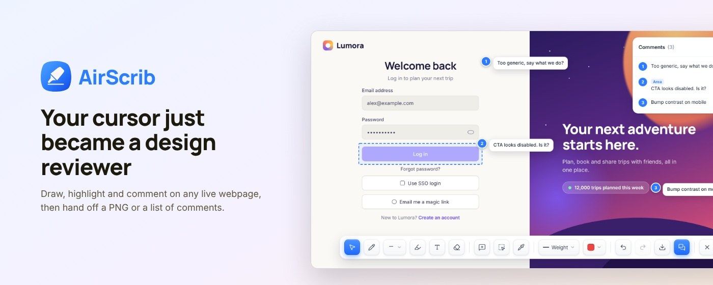

  

  
  

### 🧭 What I do

- 🎨 **UX and product design:** research, flows, design systems and high-fidelity UI
- 💻 **Front-end engineering:** turning designs into fast, accessible React sites and apps
- 🧩 **Tools for designers:** browser extensions and workflows that make design reviews easier

### 🚀 Currently building

**[AirScrib](https://airscrib.vercel.app)** is a Chrome extension that lets you draw, highlight and pin comments on any live webpage, then hand off a PNG or a numbered list of comments.

<!-- Add more projects here, one line each:
**[Project name](https://link)**: what it does, in one sentence.
-->

### 🛠️ Toolbox

  

  

### 📈 Activity

  

Open to conversations about design tools, design systems and product craft.

